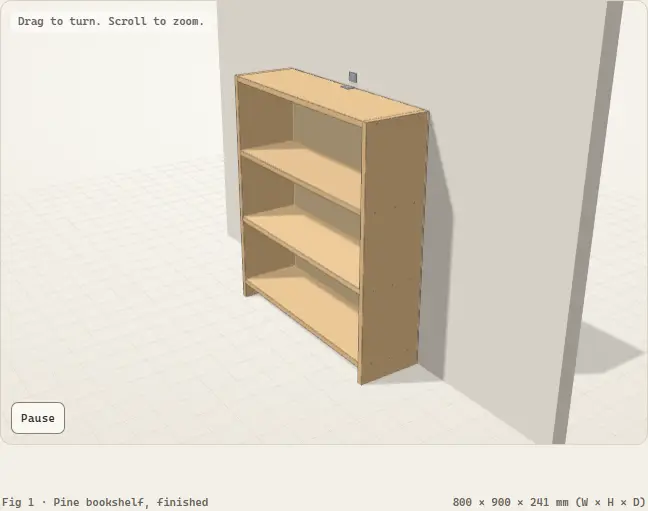
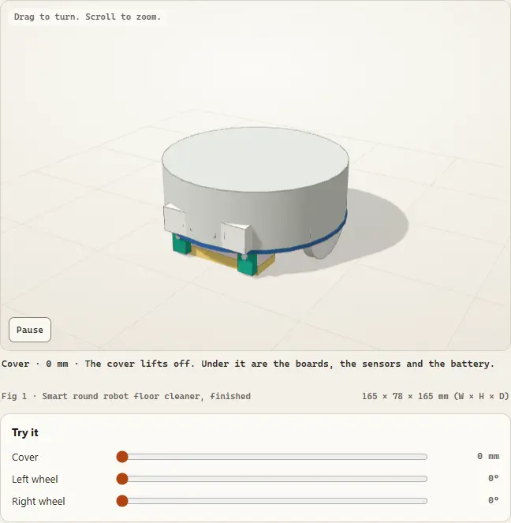
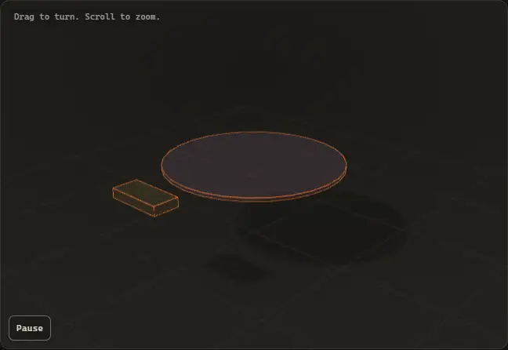
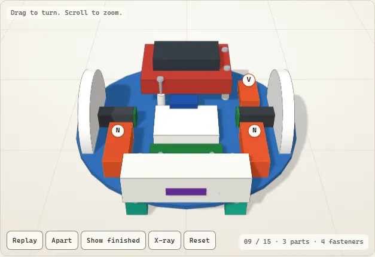
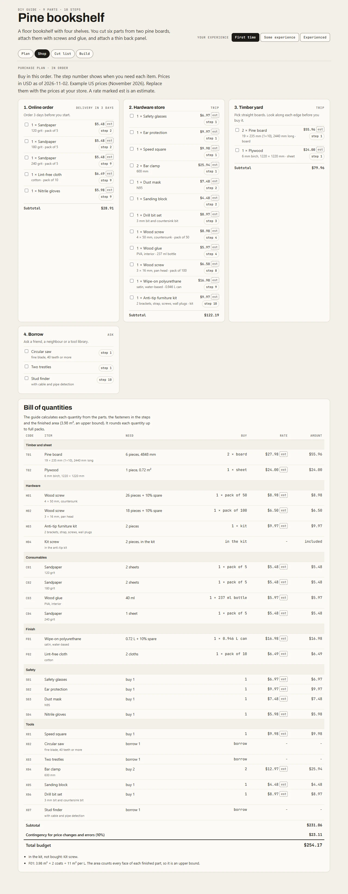
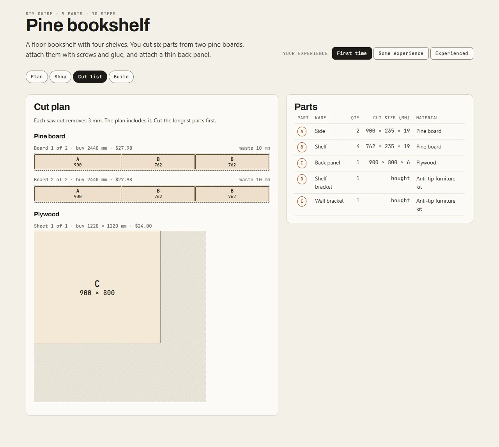
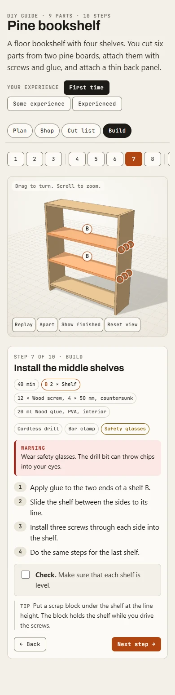
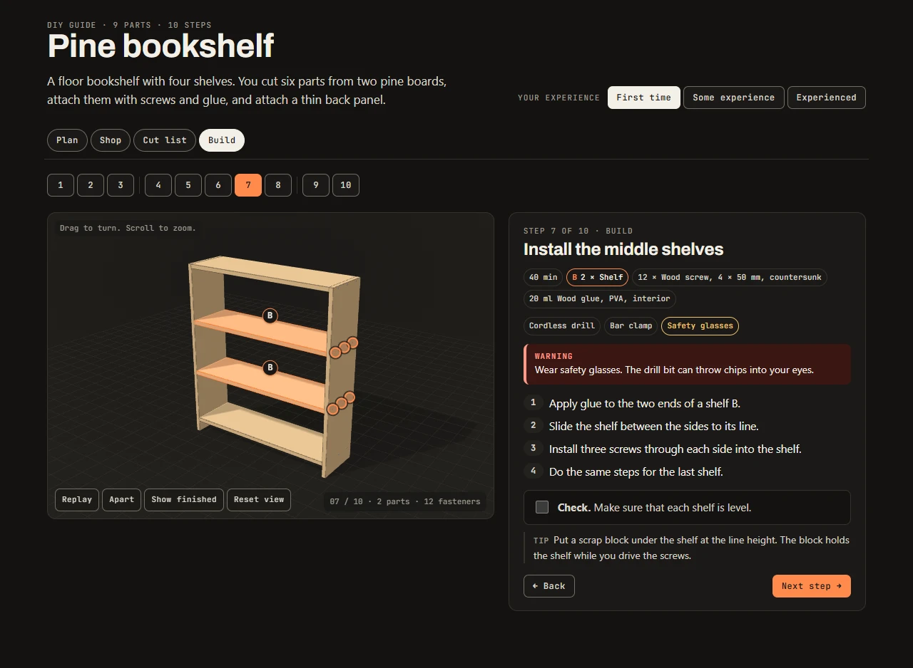

<div align="center">

<h1>Jig</h1>

<p><strong>Turn a DIY project into one build guide: a plan, a bill of quantities, a shopping plan, a cut list and 3D build steps, all from one model.</strong></p>

<p>Nine Agent Skills for Claude Code, Codex, GitHub Copilot, VS Code, Cursor, Gemini CLI and other agents.</p>

[](https://github.com/vaseem00/jig-diy/actions/workflows/ci.yml)
[](LICENSE)
[](https://nodejs.org/)
[](#requirements)
[](https://agentskills.io/specification)
[](#claude-code)
[](https://skills.sh/vaseem00/jig-diy)

[What it does](#what-it-does) · [See it work](#see-it-work) · [Quick start](#quick-start) · [Skills](#the-nine-skills) · [Install](#install) · [Examples](#examples) · [How it works](#how-it-works) · [Privacy](#what-it-fetches-and-stores) · [Limits](#limits-and-safety)

**Try a guide in your browser:** [Pine bookshelf](https://vaseem00.github.io/jig-diy/examples/pine-bookshelf/pine-bookshelf.html) · [Smart floor robot](https://vaseem00.github.io/jig-diy/docs/demos/smart-floor-robot.html) · [Raised garden bed](https://vaseem00.github.io/jig-diy/examples/raised-garden-bed/raised-garden-bed.html) · [Plywood storage cube](https://vaseem00.github.io/jig-diy/examples/plywood-storage-cube/plywood-storage-cube.html)

[](https://vaseem00.github.io/jig-diy/docs/demos/smart-floor-robot.html)

<sub>The Plan view of a guide tours itself, and the Try it sliders drive each moving part with its real value. Click the picture to open the live guide.</sub>

</div>

## What it does

A jig holds the work and guides the tool, so every person who uses it gets the same result. This pack does that for a DIY project. You tell your agent what you want to build: a bookshelf, a planter, a workbench, a storage cube, a small furniture repair. The agent writes one small project file with the parts, the materials and the steps. The jig engine then computes every number from that file and writes the guide.

The guide is one HTML page with four tabs:

- **Plan.** A 3D tour that runs by itself: the finished object sways round, each moving part (a drawer, a lid, a wheel) opens and closes, then the object goes together step by step. Any click hands control to you, and a "Try it" slider drives each moving part. Beside it: the work time, the waiting time, the cost and the tools, then the phases on a timeline.
- **Shop.** Online orders first, then one trip for each store, in the order the steps need the items. Below that, the full bill of quantities (BOQ) with codes, exact need, packs to buy, rates, contingency and tax.
- **Cut list.** Every board and sheet to buy, drawn to scale, with each cut, the saw kerf and the waste.
- **Build.** A 3D viewer that assembles the object part by part. The new parts arrive lit and lettered, and rings show where each screw goes. X-ray turns the parts built before into glass, so work inside a case shows. The step card shows the WARNINGs first, then short numbered instructions and a check.

A level switch (First time, Some experience, Experienced) changes the depth of the text, not the steps. Warnings and checks show at every level. The writing follows the rules of ASD-STE100 Simplified Technical English: a command verb first, one instruction for each sentence, 20 words or fewer.

## See it work

Each loop below is a frame-by-frame capture of a real guide page, made by the engine's own `capture` command. Open the live page to drive it yourself: drag to turn, scroll to zoom, press the buttons.

<table>
<tr>
<td width="50%" valign="top">

**The tour builds the object**

[](https://vaseem00.github.io/jig-diy/examples/pine-bookshelf/pine-bookshelf.html)

The bookshelf goes together step by step, with the step name under the view. Any click stops the tour; 25 s of quiet starts it again.<br>[Open the live guide](https://vaseem00.github.io/jig-diy/examples/pine-bookshelf/pine-bookshelf.html)

</td>
<td width="50%" valign="top">

**Moving parts, with real numbers**

[](https://vaseem00.github.io/jig-diy/docs/demos/smart-floor-robot.html)

A `motions` entry gives each moving part its real travel: the cover lifts 60 mm, and a wheel turns 360°. The slider and the 3D read the same number. If a motion hits another part, the engine warns `W_MOTION_HIT`.<br>[Open the live guide](https://vaseem00.github.io/jig-diy/docs/demos/smart-floor-robot.html)

</td>
</tr>
<tr>
<td width="50%" valign="top">

**A robot from a kit and modules**

[](https://vaseem00.github.io/jig-diy/docs/demos/smart-floor-robot.html)

Jig builds each object the real way: furniture from timber, a robot from a chassis kit, modules and 3D-printed parts. This is the dark theme.<br>[Open the live guide](https://vaseem00.github.io/jig-diy/docs/demos/smart-floor-robot.html)

</td>
<td width="50%" valign="top">

**X-ray shows the work inside**

[](https://vaseem00.github.io/jig-diy/docs/demos/smart-floor-robot.html#build/9)

At step 9 the X-ray button turns the parts built before into glass, so the new switches and sensor show. A step can open in X-ray with `view.xray`.<br>[Open step 9 live](https://vaseem00.github.io/jig-diy/docs/demos/smart-floor-robot.html#build/9)

</td>
</tr>
</table>


The live pages load three.js and the fonts from a CDN, and they keep your ticks in your own browser only. The robot guide is a demo of the page: its firmware and print files are not in this repo.

## Quick start

1. Install the plugin in Claude Code (other agents: see [Install](#install)):

   ```
   /plugin install jig --marketplace vaseem00/jig-diy
   ```

2. Ask for a guide in your own words:

   ```
   Make me a build guide for a pine bookshelf, 1800 x 800 x 300 mm. I have a drill and a circular saw. Prices in EUR.
   ```

3. Open the HTML file that the agent names. The text of every tab works with no network. The 3D view needs network, unless you ask the agent for an offline page (`--offline`).

## The nine skills

Each skill is a folder in `skills/` with its own copy of the engine, so you can install one skill alone. In Claude Code the plugin also gives each skill a `/jig:` name.

| Skill | Claude Code | Other agents | Does | Output |
|---|---|---|---|---|
| `jig` | `/jig:jig` or `/jig` | `jig`, `$jig` in Codex | The full interactive guide: plan, shopping, cut list, 3D build steps, level switch | `<id>.html` |
| `jig-plan` | `/jig:jig-plan` | `jig-plan` | A printable step-by-step plan: size, hand-offs, parts, tools, steps, time | `plan.md`, `project.json` |
| `jig-boq` | `/jig:jig-boq` | `jig-boq` | A bill of quantities and a cost estimate | Markdown, CSV or JSON table |
| `jig-buy` | `/jig:jig-buy` | `jig-buy` | A purchase plan: online orders first, one trip for each store, borrow or rent, order-by dates | Markdown checklist or JSON |
| `jig-cut` | `/jig:jig-cut` | `jig-cut` | A cut list for boards and sheets, with kerf, trim, grain and drawings to scale | Markdown and SVG, or JSON |
| `jig-3d` | `/jig:jig-3d` | `jig-3d` | Only the 3D assembly viewer, part by part | `<id>-3d.html` |
| `jig-ste` | `/jig:jig-ste` | `jig-ste` | Write, rewrite and lint any procedure in ASD-STE100 style | Findings and rewritten text |
| `jig-safety` | `/jig:jig-safety` | `jig-safety` | A safety review: WARNING and CAUTION, protective equipment, tip-over, hand-off topics | Findings and fixes |
| `jig-verify` | `/jig:jig-verify` | `jig-verify` | Check a built guide page: a review sheet of every tab and step, captures, console errors, sideways scroll, contrast, checklist | Captures and a verdict |

You do not have to name a skill. Describe what you want, and the agent picks the skill whose description matches. In Claude Code, a bare name such as `/jig-boq` also works unless another command already uses it.

## Install

The repo is one Claude Code plugin named `jig` in a marketplace named `jig-diy`. It is also a set of plain Agent Skills folders, so other agents can install it too.

### Claude Code

In a session:

```
/plugin marketplace add vaseem00/jig-diy
/plugin install jig@jig-diy
```

On Claude Code 2.1.275 or later, one line does both: `/plugin install jig --marketplace vaseem00/jig-diy`.

From a shell:

```
claude plugin marketplace add vaseem00/jig-diy
claude plugin install jig@jig-diy
```

Auto-update is off by default for marketplaces that you add. To get a new release, run `claude plugin update jig@jig-diy`, or turn on auto-update for `jig-diy` in `/plugin` under Marketplaces.

If you have a personal skill at `~/.claude/skills/jig` (for example the private 0.1 version), back it up and remove it before you install the plugin. Otherwise two skills answer to `/jig`.

### Claude Desktop and claude.ai

Add the same marketplace under **Customize > Plugins > Add marketplace**, with `vaseem00/jig-diy` as the source, and install **Jig**. The skills run their scripts in the code sandbox, which must have Node.js 22 or later.

### Any agent, with the skills CLI

The [skills CLI](https://skills.sh) copies skill folders into the folder your agent reads. It needs Node.js 22.20 or later.

```
npx skills add vaseem00/jig-diy                          # choose skills and agents
npx skills add vaseem00/jig-diy --list                   # list the skills, install nothing
npx skills add vaseem00/jig-diy --skill jig-boq          # one skill
npx skills add vaseem00/jig-diy -g -a claude-code -y     # all skills, for your user, in Claude Code
```

Use `-a codex`, `-a cursor`, `-a gemini-cli`, `-a antigravity-cli`, `-a github-copilot` or `-a opencode` for other agents. A global install replaces a folder of the same name in the agent's skills folder, so back up a `jig` folder that is already there.

### Codex

```
codex plugin marketplace add vaseem00/jig-diy
```

Then enter `/plugins` in Codex, install **Jig**, and start a new session. In Codex, call a skill as `$jig`, `$jig-boq` and so on.

### VS Code

Open the Command Palette, run **Chat: Install Plugin from Source**, and paste `https://github.com/vaseem00/jig-diy`.

### GitHub Copilot CLI

```
copilot plugin install vaseem00/jig-diy
```

### Cursor

Jig is not in the Cursor Marketplace yet. Until it is, copy the skills by hand, or use the skills CLI with `-a cursor`:

1. Download the repo (see [Manual install](#manual-install)).
2. Copy each folder from `skills/` into `~/.cursor/skills/` (all projects) or `.cursor/skills/` (one project).
3. Start a new chat.

### Gemini CLI

```
gemini extensions install https://github.com/vaseem00/jig-diy
```

The extension reads `GEMINI.md` and the skills in `skills/`.

Since 18 June 2026, Gemini CLI serves only enterprise users (Gemini Code Assist Standard or Enterprise) and users with a paid API key. On a free, Google AI Pro or Google AI Ultra account, use Antigravity CLI, and install the skills with the skills CLI:

```
npx skills add vaseem00/jig-diy -a antigravity-cli
```

### Manual install

1. Download the [latest release](https://github.com/vaseem00/jig-diy/releases/latest) as a ZIP, or the [main branch ZIP](https://github.com/vaseem00/jig-diy/archive/refs/heads/main.zip).
2. Extract it.
3. Copy the folders you want from `skills/` into your agent's skills folder:
   - Claude Code: `~/.claude/skills/` (on Windows, `%USERPROFILE%\.claude\skills\`)
   - Codex and other agents that read Agent Skills: `~/.agents/skills/`
4. Start a new session.

Each skill folder holds everything it needs: `SKILL.md`, its references and its own copy of the engine.

## Prompts to try

| Ask | Skill that answers |
|---|---|
| "I've never built anything. Make me a guide for a 60 cm spice shelf in pine. I have a cordless drill. Prices in euros." | `jig` |
| "Need a garage workbench, 6 ft x 24 in x 36 in, 2x4 frame, 3/4 plywood top. I own a circular saw and a drill." | `jig` |
| "Write the steps for a raised garden bed as a plan I can print." | `jig-plan` |
| "What will a cedar planter 600 x 300 x 300 mm cost? Give me a bill of quantities in GBP with VAT." | `jig-boq` |
| "I start the build on 14 March. What do I order online, and what do I buy at each store?" | `jig-buy` |
| "Make a cut list for four 30 1/2 in shelves and two 36 in sides from 1x12 boards sold in 6 ft and 8 ft lengths." | `jig-cut` |
| "Show me only the 3D assembly of this project, step by step." | `jig-3d` |
| "Rewrite these assembly steps in Simplified Technical English." | `jig-ste` |
| "Is this plan safe? I also want to wire the cabinet lamp into the wall socket." | `jig-safety` |
| "Check this guide page on a phone and in dark mode before I share it." | `jig-verify` |

## Examples

| Shop | Cut list |
|---|---|
|  |  |

| Build | Phone |
|---|---|
|  |  |



Each example is a project file and the guide page built from it. The tests rebuild every page and compare it byte for byte with the committed file.

| Example | Shows | Try it | Files |
|---|---|---|---|
| Pine bookshelf | The reference project: boards in millimetres, the finish from the surface area, and a wall-fixing step against tip-over | [live](https://vaseem00.github.io/jig-diy/examples/pine-bookshelf/pine-bookshelf.html) | [project](examples/pine-bookshelf/project.json) · [guide](examples/pine-bookshelf/pine-bookshelf.html) |
| Raised garden bed | Imperial units: every length in inches, shown as fractions to 1/16 | [live](https://vaseem00.github.io/jig-diy/examples/raised-garden-bed/raised-garden-bed.html) | [project](examples/raised-garden-bed/project.json) · [guide](examples/raised-garden-bed/raised-garden-bed.html) |
| Plywood storage cube | Sheet goods: plywood parts packed onto full sheets with guillotine cuts | [live](https://vaseem00.github.io/jig-diy/examples/plywood-storage-cube/plywood-storage-cube.html) | [project](examples/plywood-storage-cube/project.json) · [guide](examples/plywood-storage-cube/plywood-storage-cube.html) |
| Smart floor robot (demo page) | A chassis kit, modules and 3D-printed parts; three motions (the cover and both wheels); the Print list; X-ray | [live](https://vaseem00.github.io/jig-diy/docs/demos/smart-floor-robot.html) | [guide](docs/demos/smart-floor-robot.html) |

The "live" links open each page on GitHub Pages. To open a guide on your own machine, download the HTML file and open it in a browser. To rebuild every example, run `node scripts/build-examples.mjs`.

### Make your own demo loop

The loops in this README come from the engine. `capture --tour <s>` holds the Plan view tour at one time, a capture session can step it frame by frame, and `scripts/anim-webp.mjs` joins the frames into one animated WebP, with no ffmpeg:

```
node engine/jig.mjs capture my-guide.html --hash plan --tour 2.5 --out shots/plan-2.5s.png
node engine/jig.mjs capture my-guide.html --sheet --cols 4          # every tab and step in one review image
node scripts/anim-webp.mjs demo.webp --ms 200 frames/*.webp
```

## How it works

**One model, every number.** The agent writes one `project.json`: parts with real sizes and positions, materials with real stock sizes and prices, and steps that install the parts. The engine computes everything else from it:

```
project.json
  -> validate   types, ranges, references, "did you mean" for typos
  -> cut plan   lowest-cost boards and sheets, with kerf, end trim and grain
  -> BOQ        exact need, packs to buy, codes in each group, contingency, tax
  -> purchase   online orders first, one trip for each store, order-by dates
  -> plan       phases, work time and waiting time at each level
  -> safety     WARNING on power-tool steps, tip-over, hand-off topics, PPE
  -> geometry   overlaps, floating parts, screw positions, motion clearance
  -> STE lint   every sentence of reader text
  -> page       one HTML file: Plan, Shop, Cut list, Build
```

No number is typed twice, so the list of screws always matches the screws in the steps.

**Build to zero.** The engine writes a page only when the report shows 0 errors. Each problem has a code, a path into the project, a message and a fix. For example, a part that is longer than the longest board for sale is error `E_TOO_LONG` at `parts[3].size`. Bad input never becomes a blank cell or a wrong total. The agent fixes the model and builds again. It never edits the HTML.

**STE-style writing.** Reader text follows the writing rules of ASD-STE100: a command verb first, one instruction for each sentence, 20 words or fewer in a procedure and 25 in a description, active voice, the condition first, and no -ing verb forms. A WARNING (risk of injury) or CAUTION (risk of damage) comes before the instructions. Each step ends with a check that the reader can see or measure.

**Safe by default.** Every power-tool step needs a WARNING. Tall furniture needs a wall fixing and a step that says why. The engine screens the text for gas, mains wiring, structural work, work above 2 m, permits, asbestos and lead paint. The guide does not give steps for these. It names the professional to call.

**Deterministic.** The same project gives the same page, byte for byte. The output holds no date, no random value and no path from your machine.

[docs/ARCHITECTURE.md](docs/ARCHITECTURE.md) is the full contract: the project format, the computed model, the problem codes, the CLI and the page. [docs/design-notes.md](docs/design-notes.md) says where the ideas came from.

## What it fetches and stores

**When a guide page opens in a browser:**

- It loads three.js 0.160.0 (the core module and `OrbitControls.js`) from `cdn.jsdelivr.net` for the 3D viewer. The import map carries a sha384 integrity hash for each file, so the browser refuses a changed file. If the load fails, the Plan, Shop, Cut list and Build text still work, and the viewer says why it is empty.
- It loads the Archivo and JetBrains Mono fonts from Google Fonts (`fonts.googleapis.com` and `fonts.gstatic.com`). A page built with `--offline` has no font link and uses the system fonts.
- It keeps your ticks (done steps and bought items), level, tab and current step in the browser's `localStorage` under the key `jig:<id>`. This data stays in your browser until you clear it.
- It sends nothing. There is no telemetry, no analytics, no cookie and no account.

**When your agent runs the engine:**

- The scripts run on your machine with Node.js. They read the project file and write the outputs next to it.
- The engine makes no network request, with one exception: `build --offline` downloads three.js 0.160.0 from jsDelivr once, checks the sha384 hashes and keeps a local copy. The page then holds three.js inline (with its MIT notice) and needs no network.
- `capture` (used by `jig-verify`) starts a headless Chrome or Edge on your machine and controls it through the DevTools protocol. The browser starts with a new, empty profile, and it opens the page file or the URL that you give it. The capture command gives the browser switches that turn off its sync, pings and optimization-guide downloads. These switches do not stop all background traffic. Each time it starts, the browser still sends its own background requests to its maker (Google or Microsoft). With Chrome, this is about 10 requests: update checks, component downloads, a sign-in check, a time check and a device check-in. These requests carry no project data. The page it opens loads three.js as above.
- A project can also be a `project.mjs` module, which runs as code when the engine loads it. Use `project.json` for project files from other people.

**Installers:** the skills CLI (`npx skills`) sends anonymous install counts to skills.sh. That is the installer, not Jig. Set `DISABLE_TELEMETRY=1` to turn it off.

## Requirements

| Need | For |
|---|---|
| Node.js 22 or later | Every engine command. No npm install: the engine has no dependencies |
| Node.js 22.20 or later | The skills CLI (`npx skills add`) only |
| A browser with WebGL | The 3D viewer. The text of every tab works without it |
| Chrome 127+, Edge 127+, Safari 18+ or Firefox 138+ | The integrity check on the three.js import map |
| Chrome or Edge on the same machine | `capture` and `jig-verify` only |

## Limits and safety

- **Jig is a planning aid, not a professional.** A review by `jig-safety` is not an inspection. Read the WARNINGs, wear the protective equipment, and follow the instructions of your tools.
- **Hand-off work is out of scope.** Jig writes no steps for gas, mains wiring, structural or load-bearing changes, roofs or work above 2 m, permit work, asbestos or lead paint. It names the professional to call and covers only the safe parts of the job.
- **The hand-off screen is a safety net.** It finds common words only, so it misses some work and gives some false alarms. The agent reads each step for its meaning. A false alarm is cleared on purpose in `safety.cleared`, and the `jig-safety` review lists each cleared text for a person to read.
- **Big projects start small.** For a shed, a deck or a kitchen, Jig proposes one sub-assembly as a guide and lists what the full version adds.
- **Prices and times are estimates** unless you give them. The page marks each estimated price `est`, and it changes the times for the level of the reader. Check prices at your store before you buy.
- **Parts are boxes and cylinders**, at true size and with optional rotation. Curved parts and cut joinery (dovetails, mortises) show as simple shapes.
- **Motions are simple slides and turns.** Each moving part slides along one axis or turns about one axis line. Linkages where one part drives another are not modelled. The clearance check uses boxes, so a turned part can report a hit that is not there.
- **Cut plans are good, not always best.** Board cuts are exact up to 14 pieces of one material, then a heuristic takes over. The `cut` output says for each board material whether its plan is proven lowest cost. Rip strips are not put side by side across one board. Sheets use guillotine cuts.
- **STE-style, not certified STE.** The linter checks the rules that a script can test. It does not hold the ASD-STE100 dictionary.
- **English only.** The page text and the writing rules are in English.

## Repository layout

<details>
<summary>Folders and files</summary>

```
.claude-plugin/        Claude Code plugin and marketplace manifests
plugin.json            Agent Plugins manifest (Codex, Cursor, Copilot, VS Code)
gemini-extension.json  Gemini CLI extension manifest, with GEMINI.md
skills.sh.json         Skill groups for the skills.sh repo page
engine/                The canonical engine: CLI, pure modules, page runtime, schema, shared docs
skills/<name>/         One folder for each skill, with a generated copy of engine/
examples/<id>/         Example projects and their built pages (golden files)
evals/                 The `claude plugin eval` suite
tests/                 node:test suite
scripts/               sync-engine, build-examples, bump-version, set-owner, check-repo
docs/                  ARCHITECTURE.md, design-notes.md, PUBLISHING.md
docs/demos/            Built guide pages for the live demos on GitHub Pages
.github/               CI, issue forms, pull request template, README images
```

</details>

## Contributing

Bug reports, example projects and fixes are welcome. Read [CONTRIBUTING.md](CONTRIBUTING.md) first. Use the [issue forms](https://github.com/vaseem00/jig-diy/issues/new/choose) for bugs and project requests, and report security problems privately as [SECURITY.md](SECURITY.md) says. Every change is in the [CHANGELOG](CHANGELOG.md). This project follows the [Code of Conduct](CODE_OF_CONDUCT.md).

## Licence

MIT. See [LICENSE](LICENSE). three.js and the fonts have their own licences, listed in [THIRD_PARTY_NOTICES.md](THIRD_PARTY_NOTICES.md). The design owes much to the MIT-licensed [anatomy](https://github.com/wheresryan22/anatomy) skill by wheresryan22 and to [visual-explainer](https://github.com/nicobailon/visual-explainer) by nicobailon; [docs/design-notes.md](docs/design-notes.md) gives the details.

## ASD-STE100

Jig writes in the style of ASD-STE100 Simplified Technical English. It is STE-style, not certified STE, and it does not reproduce the STE dictionary. ASD-STE100 is a trademark of ASD (the AeroSpace, Security and Defence Industries Association of Europe). Jig has no connection with ASD.
